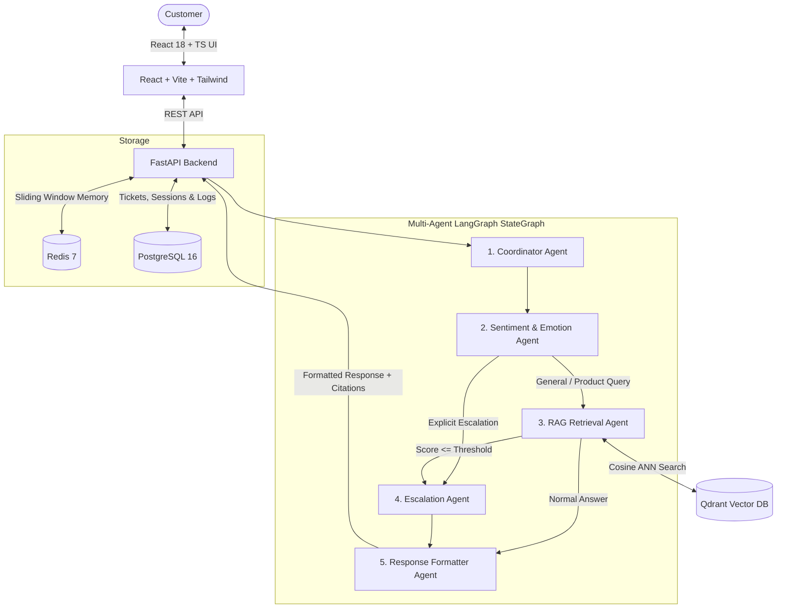

# 🤖 Multi-Agent Customer Support Assistant

[](https://www.python.org/)
[](https://fastapi.tiangolo.com/)
[](https://react.dev/)
[](https://www.typescriptlang.org/)
[](https://vitejs.dev/)
[](https://tailwindcss.com/)
[](https://langchain-ai.github.io/langgraph/)
[](https://qdrant.tech/)
[](https://www.postgresql.org/)
[](https://redis.io/)
[](LICENSE)

An enterprise-grade, placement-ready **Multi-Agent Customer Support Assistant** designed to autonomously resolve complex customer queries, retrieve grounded policy answers via semantic vector search, detect frustration in real time, and automatically escalate critical issues to human desks.

[Live](https://multi-agent-customer-support-three.vercel.app/)

---

## 🏛️ System Architecture



---

## 🚀 Key Features

* **Decoupled Multi-Agent Graph:** Uses LangGraph to orchestrate 5 specialized agents with state tracking and trajectory visualization.
* **Vectorized Knowledge Base (RAG):** Stores return policies, warranty terms, shipping guidelines, and FAQs in **Qdrant** with 1536-dim embeddings.
* **Real-time Frustration & Sentiment Escalation:** Continuously scores customer emotional valence; automatically creates support tickets in **PostgreSQL** when frustration thresholds are breached.
* **Human Support Desk Dashboard:** Live operations dashboard built with **React Query** polling every 10s to inspect tickets, update statuses, and log agent notes.
* **Interactive Qdrant Playground:** Test semantic vector similarity scoring in real time directly from the Knowledge Base UI.
* **Resilient Graceful Fallbacks:** Built-in in-memory fallbacks for Qdrant, Redis, and SQLite so you can develop and run tests locally even without Docker.

---

## 🛠️ Tech Stack Breakdown

| Component | Technology | Rationale |
| :--- | :--- | :--- |
| **Backend API** | FastAPI (Python 3.11+) | Async high-performance REST API, automatic OpenAPI / Swagger documentation. |
| **Agent Orchestration** | LangGraph + LangChain | Stateful multi-agent graph with conditional edge routing and trajectory tracking. |
| **Vector Database** | Qdrant | Fast Rust-based vector search engine using HNSW cosine similarity. |
| **Relational Database** | PostgreSQL 16 | ACID storage for users, sessions, conversation histories, and tickets. |
| **Memory & Cache** | Redis 7 | Sub-millisecond sliding window conversational buffer (8 turns). |
| **Frontend Framework** | React 18 + TypeScript + Vite | Modern reactive single-page app with lightning-fast HMR. |
| **State Management** | TanStack React Query v5 | Automated server-state caching, background refetching, and polling. |
| **Styling** | Tailwind CSS | Utility-first styling with responsive layouts and custom scrollbars. |
| **DevOps & Containers**| Docker & Docker Compose | Multi-container production deployment (`backend`, `frontend`, `postgres`, `qdrant`, `redis`). |
| **CI/CD** | GitHub Actions | Automated linting, test execution (Pytest), and build verification. |

---

## ⚡ Quickstart Guide

### Option 1: Run with Docker Compose (Recommended)

1. Make sure **Docker Desktop** is running.
2. In the project root, start all 5 services:
   ```bash
   docker compose up --build
   ```
3. Access the applications:
   * **Frontend UI (Customer Chat & Support Desk):** [http://localhost:5173](http://localhost:5173)
   * **Backend API Documentation (Swagger):** [http://localhost:8000/docs](http://localhost:8000/docs)
   * **Qdrant Vector DB Web Console:** [http://localhost:6333/dashboard](http://localhost:6333/dashboard)

---

### Option 2: Run Locally (Without Docker)

The backend includes automatic in-memory fallbacks for Qdrant, Redis, and SQLite, allowing you to run everything directly on your machine without external services running!

#### Step 1: Start Backend (FastAPI)
```bash
cd backend
python -m venv venv
# On Windows:
.\venv\Scripts\activate
# On Linux/macOS:
source venv/bin/activate

pip install -r requirements.txt
uvicorn app.main:app --reload --port 8000
```
*Backend will be running at [http://localhost:8000](http://localhost:8000)*

#### Step 2: Start Frontend (React + Vite)
```bash
cd frontend
npm install
npm run dev
```
*Frontend will be running at [http://localhost:5173](http://localhost:5173)*

---

## 🧪 Running Automated Tests

Run the complete integration and unit test suite with Pytest:

```bash
cd backend
pytest ../tests -v
```

Tests verify:
* Coordinator agent intent routing (greetings, RAG queries, complaints)
* Sentiment agent thresholding and escalation detection
* Qdrant vector index upsert and cosine similarity search
* End-to-end FastAPI chat, ticket creation, and knowledge endpoints

---

## 📂 Project Directory Structure

```text
Multi-Agent-Customer-Support/
├── backend/
│   ├── app/
│   │   ├── agents/          # Coordinator, Sentiment, RAG, Escalation, Response, Graph
│   │   ├── api/             # FastAPI routes (/chat, /tickets, /knowledge, /health)
│   │   ├── core/            # Config, logging, settings
│   │   ├── db/              # SQLAlchemy models (PostgreSQL) and sessionmaker
│   │   ├── memory/          # Redis sliding window session manager
│   │   ├── schemas/         # Pydantic v2 validation models
│   │   ├── services/        # Default enterprise knowledge base seeder
│   │   ├── vector_store/    # Qdrant client & embedding generator
│   │   └── main.py          # Application entrypoint
│   ├── Dockerfile
│   └── requirements.txt
├── frontend/
│   ├── src/
│   │   ├── components/      # ChatWindow, ChatInput, SentimentBadge, TicketList, KnowledgeManager
│   │   ├── pages/           # ChatPage, TicketsPage, KnowledgePage
│   │   ├── services/        # Axios API client & TanStack React Query hooks
│   │   ├── types/           # TypeScript interfaces
│   │   ├── App.tsx          # React Router setup
│   │   └── main.tsx
│   ├── package.json
│   ├── vite.config.ts
│   ├── tailwind.config.js
│   ├── Dockerfile
│   └── nginx.conf
├── tests/                   # Pytest test suite (agents, RAG, API, database)
├── docs/
│   ├── system-design.md     # Detailed architecture & Mermaid workflows
│   ├── database-design.md   # PostgreSQL schema & Qdrant vector specs
│   ├── resume-bullets.md    # Placement resume bullet points
│   ├── interview-qa.md      # 10+ technical interview questions & answers
│   └── ADR/                 # 5 Architecture Decision Records (Qdrant, LangGraph, etc.)
├── .github/workflows/
│   └── ci.yml               # Automated CI/CD pipeline
├── docker-compose.yml       # Production multi-container orchestration
└── README.md
```

---

## 📄 License
This project is open-source under the [MIT License](LICENSE).
