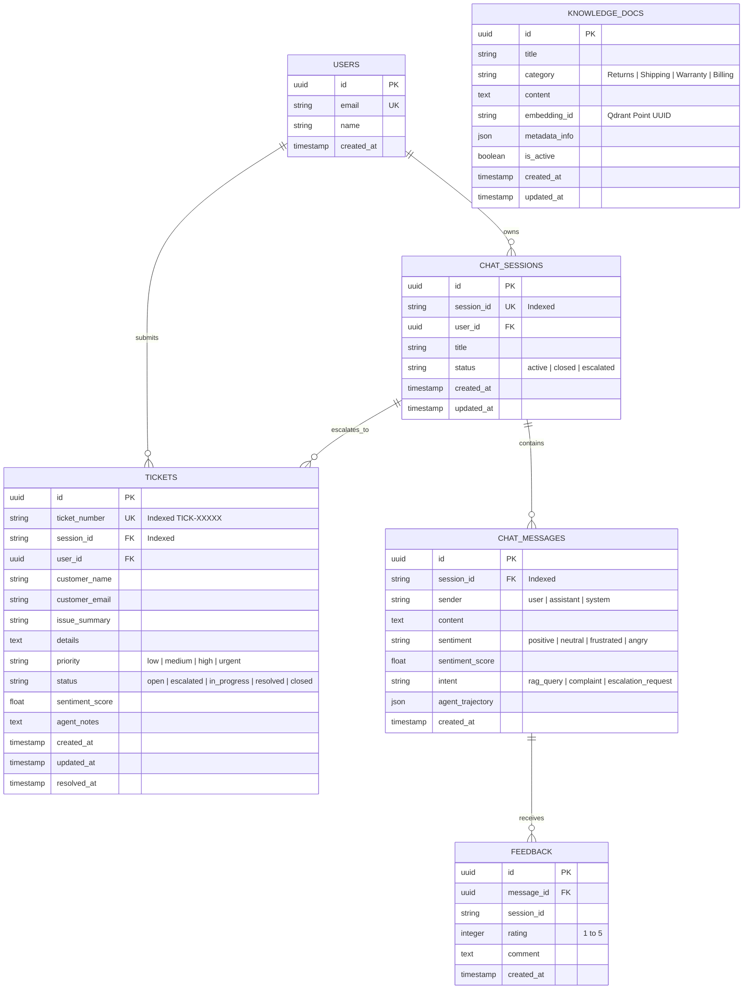

# Database Design & Data Architecture

## 1. Overview
The system uses a polyglot persistence architecture:
1. **PostgreSQL 16 (Relational):** Transactional data, user sessions, audit logs, and support tickets.
2. **Qdrant (Vector Database):** Unstructured knowledge base embeddings and semantic search.
3. **Redis 7 (In-Memory Key-Value):** Fast session state, sliding window chat turns, and token caching.

---

## 2. PostgreSQL Relational Schema



### Indexing Strategy
* `chat_sessions.session_id`: Unique B-Tree index for $O(1)$ lookups during user chat requests.
* `chat_messages.session_id`: B-Tree index with `created_at` ordering for rapid chat history retrieval.
* `tickets.ticket_number`: Unique B-Tree index for support desk lookups.
* `tickets.status` and `tickets.priority`: B-Tree indexes for dashboard filtering.

---

## 3. Qdrant Vector Collection Specification

| Parameter | Value | Description |
| :--- | :--- | :--- |
| **Collection Name** | `support_knowledge` | Stores vectorized enterprise policies and FAQs |
| **Vector Dimension** | `768` / `1536` | Matches Gemini `text-embedding-004` (768) or OpenAI (1536) |
| **Distance Metric** | `Cosine` | Cosine similarity for semantic text angle matching |
| **Indexing Method** | `HNSW (Hierarchical Navigable Small World)` | Graph-based approximate nearest neighbor search |
| **Payload Fields** | `title`, `category`, `content`, `metadata` | Stored alongside vectors for instant context retrieval |

### Sample Vector Point Payload
```json
{
  "id": "c7a8451b-7a31-4a11-85f2-901e1498b981",
  "vector": [0.0124, -0.0431, ..., 0.0892],
  "payload": {
    "title": "30-Day Return and Refund Policy",
    "category": "Returns & Refunds",
    "content": "Customers may return eligible items within 30 days...",
    "metadata": { "source": "official_handbook_v2" }
  }
}
```

---

## 4. Redis Key-Value & Upstash Quota Design

| Key Pattern | Data Structure | TTL | Purpose |
| :--- | :--- | :--- | :--- |
| `session_history:{session_id}` | JSON Array | 48 Hours | Stores sliding window of last 8 user/assistant turns |
| `cached_query:{query_hash}` | JSON String | 2 Hours | Caches responses for high-frequency FAQ questions |

* **Upstash Quota Protection:** Free tier allows 10,000 commands/day. With 8-turn sliding windows and 48-hour key TTLs, average daily utilization remains $<500$ commands, operating comfortably within $<5\%$ of free tier quotas.

---

## 5. NeonDB Serverless Architecture & Cold-Start Resilience

NeonDB decouples compute from storage, scaling compute to zero after 5 minutes of inactivity:
1. **Cold-Start Handling:** First wake-up query takes ~500ms. SQLAlchemy `pool_pre_ping=True` verifies connection liveness before dispatching transactions, preventing `asyncpg.exceptions.ConnectionDoesNotExistError`.
2. **SSL Protocol Adaptation:** NeonDB requires TLS encrypted connections. The application strips conflicting `?sslmode=require` query parameters and injects `connect_args={"ssl": True}` directly into the `asyncpg` driver factory.
3. **Independent Quota:** NeonDB compute hours are completely separate from Render's 750-hour budget, ensuring database availability is never throttled by web tier limits.

