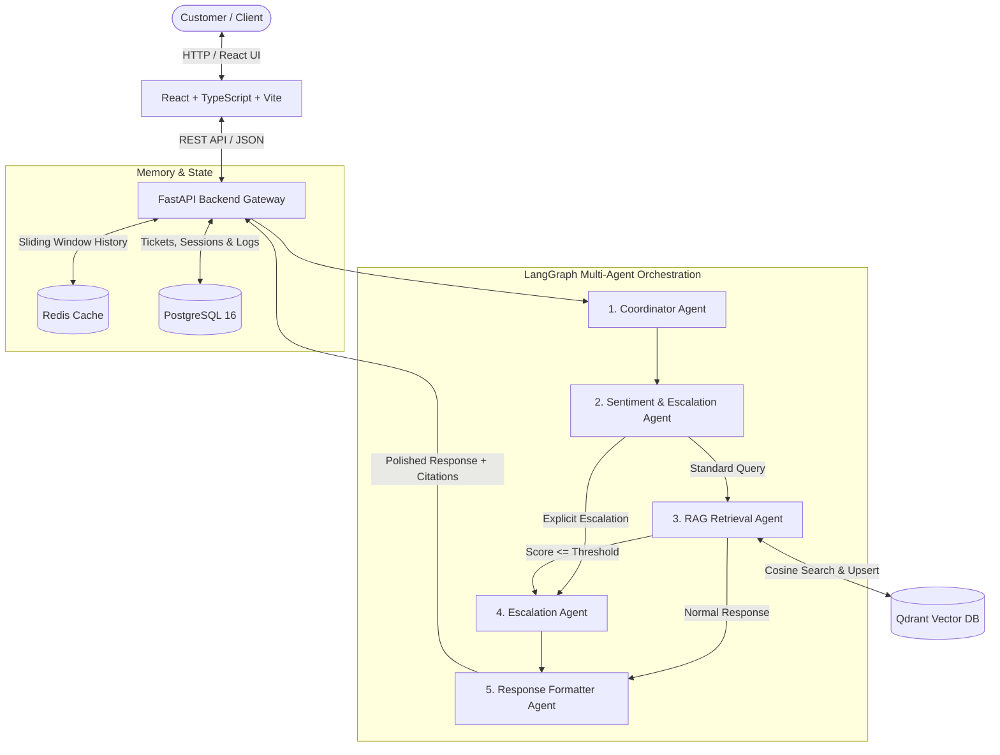
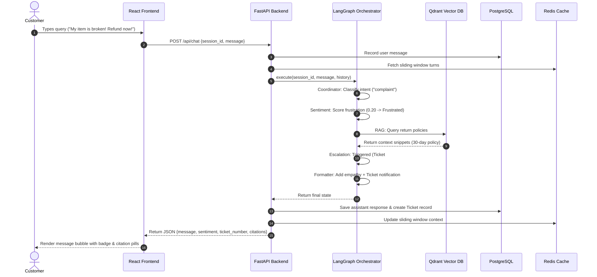
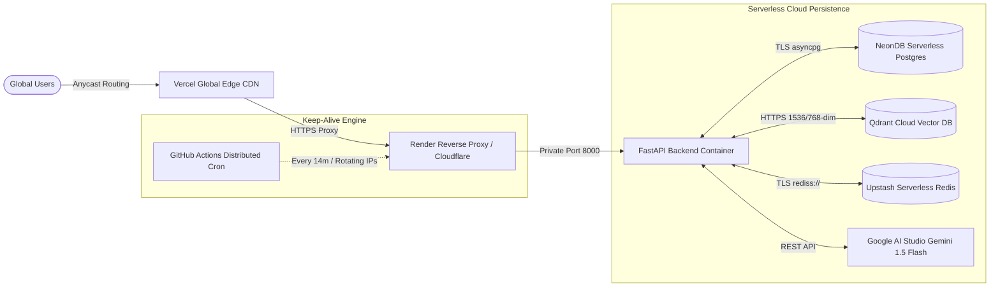

# System Design: Multi-Agent Customer Support Assistant

## 1. Executive Architecture Overview

The **Multi-Agent Customer Support Assistant** is a distributed, stateful AI support platform designed to handle complex customer queries through collaborative, specialized AI agents. Rather than relying on a monolithic LLM prompt, the system decouples responsibilities across five distinct agent roles:

1. **Coordinator Agent:** Semantic intent router and task dispatcher.
2. **Sentiment & Escalation Agent:** Real-time emotion scoring and threshold-based human handoff.
3. **RAG Retrieval Agent:** Vectorized semantic search over Qdrant with fact grounding.
4. **Escalation Agent:** Automated ticketing and priority assignment in PostgreSQL.
5. **Response & Persona Agent:** Tone adaptation, empathetic phrasing, and brand persona formatting.

---

## 2. Multi-Agent StateGraph Workflow

The agent lifecycle is orchestrated via a directed acyclic state graph (LangGraph):

---

## 3. Component Responsibilities

### 3.1 Coordinator Agent
* **Input:** Raw user prompt and last 2 conversation turns.
* **Logic:** Evaluates intent using few-shot classification and keyword heuristics:
  * `greeting`: Friendly icebreakers.
  * `escalation_request`: Explicit demands for a manager/representative.
  * `complaint`: Severe dissatisfaction, threats, or claims of damaged goods.
  * `rag_query`: Product policies, return steps, warranty instructions.
  * `general_inquiry`: General conversational questions.
* **Output:** Updated state with classified intent.

### 3.2 Sentiment Agent
* **Input:** User message and conversation trajectory.
* **Logic:** Assigns an emotional valence between `0.0` (severe distress/anger) and `1.0` (delight/satisfaction).
* **Thresholding:** If score $\le 0.35$ or intent is `escalation_request`, sets `escalation_required = True`.

### 3.3 RAG Retrieval Agent
* **Input:** User query.
* **Search Engine:** Queries Qdrant vector database using cosine distance over 1536-dimensional embeddings (`text-embedding-3-small`).
* **Grounding:** Synthesizes response strictly based on retrieved context, appending document titles as verifiable citations.

### 3.4 Escalation Agent
* **Input:** State flagged with `escalation_required = True`.
* **Action:** Generates ticket ID (`TICK-XXXX`), classifies priority (`urgent`, `high`, `medium`), and packages context for human agent intervention.

### 3.5 Response Formatter Agent
* **Input:** Raw answer, sentiment label, and escalation details.
* **Action:** Adapts conversational tone. If frustrated, leads with genuine empathy. If escalated, highlights the ticket number and human review timeline.

---

## 4. Scalability & Fault Tolerance

1. **Graceful Fallbacks:** If external LLM or database connections experience transient outages:
   * Redis falls back to an in-memory thread-safe dictionary.
   * Qdrant falls back to local in-memory vector indexing.
   * PostgreSQL falls back to local SQLite for zero-downtime offline testing.
2. **Stateless Backend Nodes:** FastAPI instances store no local session state; all state lives in Redis and PostgreSQL, enabling horizontal auto-scaling behind an Nginx or AWS ALB load balancer.
3. **Sliding Window Token Control:** Session memory retains only the last 8 turns (16 messages), ensuring LLM token usage remains strictly bounded and deterministic.

---

## 5. Production Cloud Topology & Zero-Cost Architecture

The production environment leverages high-reliability free tiers across specialized cloud providers:

### 5.1 Render 750-Hour Quota Management
* **The Math:** In a 31-day month, total hours are $744$. Render grants $750$ free instance hours per calendar month ($6\text{ hours}$ margin).
* **CI/CD Overlap Prevention:** Redeployments run parallel containers for 5–10 minutes. To guarantee zero mid-month exhaustion, keep-alive pings can be constrained to active business windows (e.g., 08:00–24:00), using only 496 hours/month.
* **Exhaustion Behavior:** If 750 hours are exceeded, Render suspends the service until the 1st of the next month (00:00 UTC), upon which it automatically re-activates with zero manual intervention.

### 5.2 Anti-Bot & WAF Bypass Strategy for Keep-Alive Pings
* **Problem:** Fixed-IP cron pingers sending identical requests every 5 minutes get flagged by Render/Cloudflare WAF as scrapers or bots.
* **Solution:** `.github/workflows/keep-alive.yml` schedules runs from rotating GitHub Actions Azure runner IPs worldwide, with randomized 0–30s delay jitter, genuine browser headers (`User-Agent: Mozilla/5.0...`), and hits an ultra-lightweight `/api/ping` route that executes in $<1\text{ ms}$ without consuming DB compute.

### 5.3 IP Shielding & Reverse Proxy Protection
* **Frontend:** Deployed on Vercel's Edge Network with strict security headers (`X-Content-Type-Options: nosniff`, `X-Frame-Options: DENY`, `HSTS`).
* **Backend:** Render acts as an L7 reverse proxy. The actual origin container IP is never exposed to public DNS; all incoming requests pass through Cloudflare/Render load balancers.

